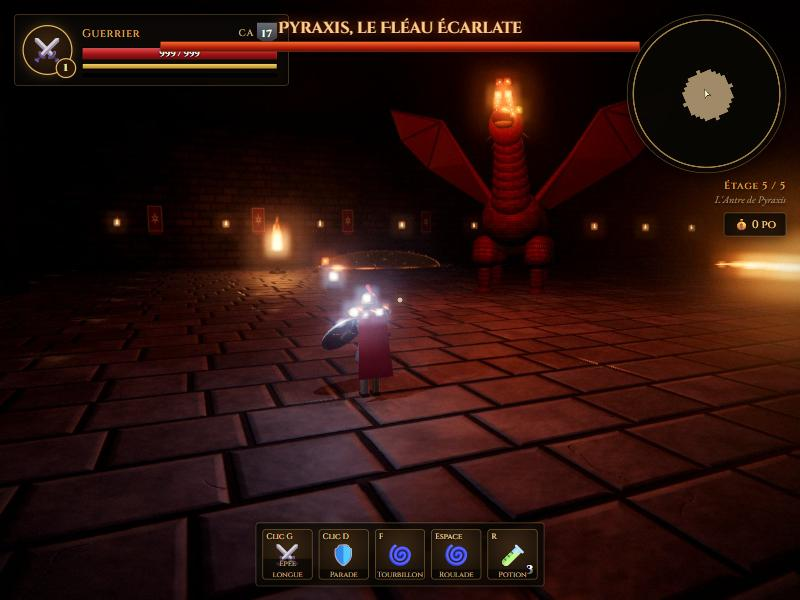
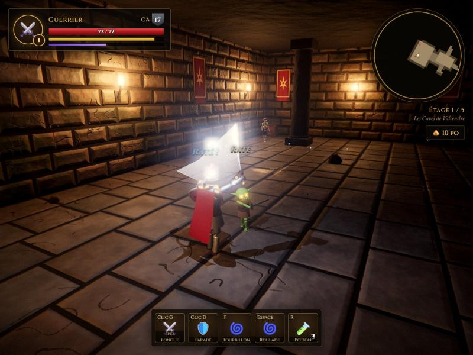
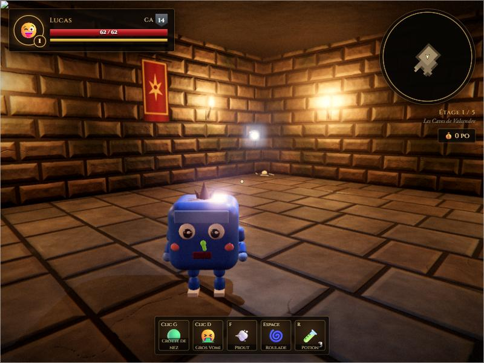
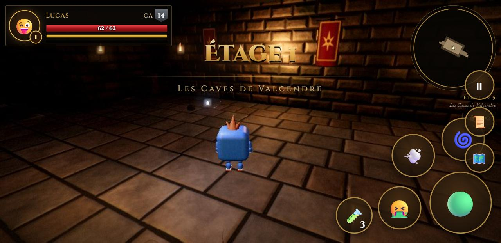

# 🐉 La Crypte du Dragon

Un jeu de rôle d'action en 3D dans le navigateur, inspiré de *Donjons & Dragons* : descends cinq étages de donjon, lance les dés du destin et terrasse **Pyraxis, le Fléau Écarlate**.

**▶ [Jouer en ligne](https://lennoxvdb.github.io/la-crypte-du-dragon/)** · **📱 [Télécharger l'APK Android](https://github.com/lennoxvdb/la-crypte-du-dragon/releases/latest)**



## Le jeu

- **4 héros jouables**
  - ⚔️ **Guerrier** : combo d'épée en 3 coups, parade au bouclier (parade parfaite = critique assuré), Tourbillon.
  - 🔥 **Magicien** : Trait de feu à volonté, Projectile magique qui ne rate jamais, Boule de feu, téléportation.
  - 🗡️ **Roublard** : dagues jumelles, critique sur 19-20, attaque sournoise dans le dos, dagues de jet, Pas de l'ombre.
  - 😜 **Lucas** : le héros de *Prout Évasion* en 3D ! Crottes de nez, Gros Vomi et Prout propulseur.
- **Règles du d20** : chaque coup est un jet contre la Classe d'Armure, avec critiques, échecs critiques, jets de sauvegarde et dés de dégâts affichés dans le journal de combat.
- **5 étages générés au hasard** : caves, catacombes, forge des gobelins, sanctuaire profané, puis l'antre du dragon.
- **Monstres** : gobelins, squelettes, squelettes archers, cubes gélatineux, ogres, et un dragon rouge en deux phases (morsure, griffes, queue, souffle de feu, pluie de météores, invocations).
- **Progression** : expérience, niveaux, dons à choisir, objets magiques dans les coffres, potions, fontaines sacrées, pièges.
- **Graphismes 100 % procéduraux** : aucun fichier image ou modèle 3D. Textures, personnages et sons sont générés par le code (Three.js + WebAudio). Éclairage dynamique, ombres, bloom, étalonnage des couleurs.

| Combat | Lucas | Sur téléphone |
|---|---|---|
|  |  |  |

## Commandes

| PC | Téléphone | Action |
|---|---|---|
| ZQSD / WASD | joystick (moitié gauche) | se déplacer |
| souris | glisser (moitié droite) | caméra |
| clic gauche | gros bouton | attaque principale |
| clic droit | bouton 2 | capacité secondaire |
| F | bouton 3 | capacité spéciale |
| Espace | bouton roulade | esquive (invulnérable) |
| Maj | — | courir |
| R | 🧪 | potion de soins |
| E | ✋ | interagir |
| Tab / M / Échap | 📜 / 🗺️ / ⏸ | fiche, carte, pause |

## Structure

```
dnd3d/          le jeu web (index.html + modules JS)
apk/            construction de l'APK Android
  build-web.mjs   assemble le jeu hors-ligne (esbuild + Three.js + polices)
  android/        projet Android (WebView plein écran)
```

### Lancer en local

Servir le dossier `dnd3d/` avec n'importe quel serveur web (par exemple XAMPP), puis ouvrir `index.html`.

### Construire l'APK

Prérequis : Node.js, JDK 17+, SDK Android (API 36).

```bash
cd apk
npm install
node build-web.mjs
cd android
gradle assembleRelease
```

L'APK se trouve dans `apk/android/app/build/outputs/apk/release/`.
